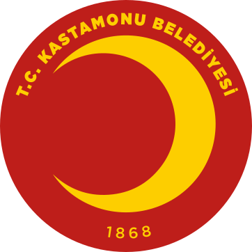

<div align="center">
  
  <h1>T.C. Kastamonu Belediyesi</h1>
  <p><strong>Açık Kaynak Kodlu Yerel Yönetim, Rust Çekirdeği, RustGIS ve Akıllı Şehir Teknolojileri</strong></p>
  <p>
    <a href="https://kastamonu.bel.tr"></a>
    <a href="https://x.com/kastamonubld"></a>
    
    
    
    
    
  </p>
</div>

---

### Kurumsal Vizyon ve Kamu Açık Kaynak Politikası

T.C. Kastamonu Belediyesi olarak, kentsel hizmetlerin dijitalleşmesinde şeffaflık, sürdürülebilirlik, yerli ve milli yüksek performanslı üretim, bellek güvenliği (memory safety) ve sıfır güven (Zero Trust) standartlarını esas alıyoruz.

Organizasyonumuz altındaki çekirdek projeler; harici ağlara bağımlılığı kaldıran yerel **RustGIS** CBS motoru, **NIST FIPS 203 & 204** kuantum sonrası (post-quantum) kriptografik kalkan, Sayıştay uyumlu SHA-512 WORM denetim kütüğü ve **TS 13298 / 3473 Sayılı Kanun** uyumlu Dijital Kurum Arşivi altyapısıyla **Rust** mimarisine geçirilmiştir.

---

### Entegre Belediye Platformu Mimarisi (Sürüm 3.0)

```
+---------------------------------------------------------------------------------------------------+
|                                     T.C. KASTAMONU BELEDİYESİ                                     |
|                       Akıllı Şehir, Dijital Arşiv ve Kurumsal Proje Yönetim Portalı               |
+-------------------------------------------------+-------------------------------------------------+
|                                                 |                                                 |
|        AKILLI ŞEHİR & RUSTGIS (CBS)             |            DİJİTAL KURUM ARŞİVİ                 |
|                   (/akilli_sehir/)              |                    (/)                            |
|                                                 |                                                 |
|  - RustGIS Yerel Harita ve Kiremit (Tile) Motoru |  - TS 13298 Standart Dosya Planı (SSDP)         |
|  - 26 Müdürlük Canlı Telemetrisi & 2.060 IoT     |  - 3473 Sayılı Kanun Saklama & İmha Matrisi    |
|  - Deprem Erken Uyarı (KAF Hattı) & Afet Lojistiği |  - SHA-256 + SHA3-256 Çift Hash Bütünlük      |
|  - KASKI Akıllı Su Sayacı & Kaçak Tespiti       |  - Form 1 Birim Arşivi -> Kurum Arşivi Devir    |
+-------------------------------------------------+-------------------------------------------------+
|                                                 |                                                 |
|       KURUMSAL PROJE YÖNETİMİ (PYS)             |        POST-QUANTUM SİBER SAVUNMA               |
|                   (/pys/)                       |                (kb-crypto)                      |
|                                                 |                                                 |
|  - 5393 Sayılı Kanun M41 Stratejik Hedef (SH)  |  - NIST FIPS 203 (ML-KEM) & 204 (ML-DSA)       |
|  - 5018 Sayılı Kanun M9 Analitik Bütçe Tertibi |  - Bell-LaPadula (No Read Up, No Write Down)    |
|  - Maker-Checker / İki Kişi Kuralı (Two-Man)   |  - FIPS 140-3 RAM Zeroization (Bellek Temizliği)|
|  - EVM (Kazanılmış Değer: CPI, SPI Analizi)     |  - Sayıştay WORM SHA-512 Kriptografik Blokzincir|
+-------------------------------------------------+-------------------------------------------------+
```

---

### Teknik Birimler ve Yetki Matrisi

#### Araştırma ve Geliştirme Müdürlüğü (A&G)
* **RustGIS & CBS Entegrasyonu:** Dış harita servislerine bağımlılığı sıfırlayan çevrimdışı (air-gap) harita kiremit ve vektör katmanlarının işletimi.
* **Yapay Zeka ve Telemetri:** 26 müdürlüğe ait 2.060 aktif sensör noktasından gelen kentsel telemetrinin işlenmesi ve mahalle bazlı risk erken uyarı modelleri.

#### Bilgi İşlem Müdürlüğü (BİM)
* **Kuantum Sonrası Siber Kalkan (PQC):** Kurumsal verilerin gelecekteki kuantum bilgisayar tehditlerine karşı kafes tabanlı şifrelenmesi.
* **Mevzuat & Sayıştay Uyumluluğu:** 5393 M41, 5018 M9 ve 6698 KVKK gereği veri maskeleme, çift onay (maker-checker) ve WORM değişmez denetim kütüğü.

---

### Kurumsal İlkeler

1. **Tam Bellek ve İş Parçacığı Güvenliği:** Sistem bileşenleri Rust derleyicisinin derleme zamanı güvencesiyle çalışır; bellek sızıntısı ve çöp toplayıcı (GC) duraksaması yaşanmaz.
2. **Kişisel Verilerin Korunması (KVKK):** TCKN, ad/soyad, IBAN ve telefon numaraları K-Anonimlik algoritmalarıyla otomatik maskelenir.
3. **Standartlara Tam Uyum:** TS 13298, 5070 E-İmza, RFC 6962 Merkle Ağacı ve T.C. Cumhurbaşkanlığı BİGR Seviye 3 uyumluluğu bağımsız baş denetçi **Jev** ve **Yazılım Konseyi** tarafından akredite edilmiştir.

---

### Resmi İletişim Kanalları

* **Resmi Web Portalı:** [kastamonu.bel.tr](https://kastamonu.bel.tr)
* **Konum:** Kuzeykent Mahallesi, Belediye Hizmet Binası, Merkez / Kastamonu, Türkiye
* **E-Posta:** `bilgiislem@kastamonu.bel.tr` / `arge@kastamonu.bel.tr`
* **Resmi Sosyal Medya:** [@kastamonubld](https://x.com/kastamonubld)
